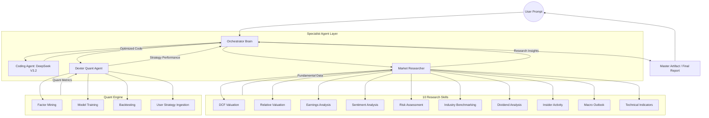

# Agent Hierarchy & Data Flow

### Data Flow Overview:
1. **Initiation**: User sends a complex financial/coding request to the **Orchestrator**.
2. **Delegation**: The Orchestrator analyzes the intent and delegates tasks:
    - **DeepSeek (Coder)**: Handles algorithm optimization and script generation.
    - **Market Researcher**: Triggers 10 specialized fundamental skills (e.g., DCF, Sentiment) to gather ground-truth data.
    - **Dexter Quant**: Manages factor mining and backtesting via Qlib to validate quantitative hypotheses.
3. **Synthesis**: Specialist agents return their specific outputs (data points, code blocks, backtest results).
4. **Conclusion**: The Orchestrator compiles these into a structured **Master Artifact** delivering a comprehensive final report to the User.
